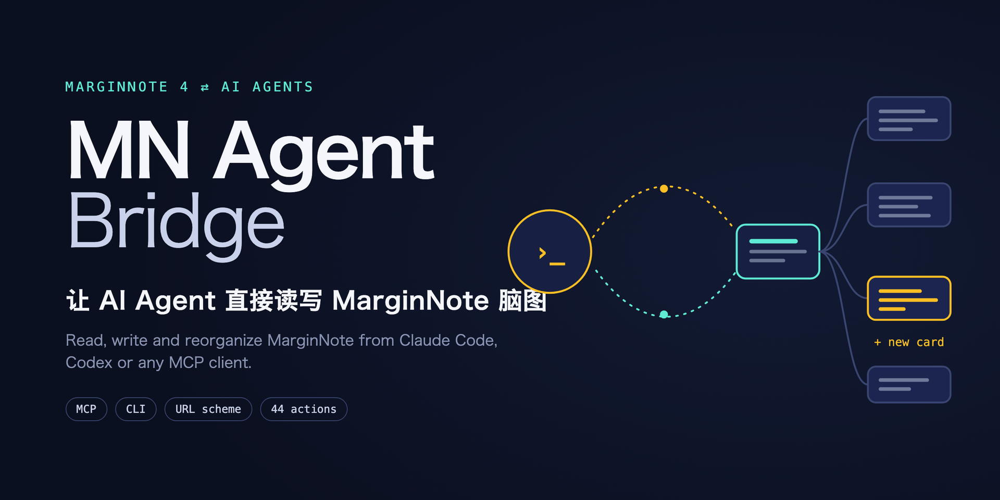

<p align="center">
  
</p>

<p align="center">
  <a href="LICENSE"></a>
  
  
  
  
</p>

<p align="center"><b>简体中文</b> · <a href="README.en.md">English</a></p>

---

**MN Agent Bridge** 是一个 MarginNote 4 插件 + 命令行 + MCP 服务器。装好之后，Claude Code、Codex、Cursor 这类 AI Agent 就能**直接**读你的脑图、找卡片、建卡片、改评论、打标签、整棵树地导入导出——每一步都是 MarginNote 里的一次可撤销操作。

> 「把这页题按格式挂到『多元函数积分学』下面」「把第 3 章错题汇总成 Markdown」「给这 20 张卡片补上知识点标签」——说一句话，Agent 自己完成。

## ✨ 能做什么

| | |
| --- | --- |
| 🧠 **读** | 笔记本列表、整棵脑图（JSON / Markdown / 大纲）、卡片详情、评论、标签、图片与手写、PDF 目录与页面文字、你当前打开和选中的内容 |
| ✏️ **写** | 建卡、改卡、删卡、移动、克隆、链接、评论增删改排序、标签、颜色，**一段 Markdown 直接变成一棵卡片树**（支持 LaTeX） |
| 📦 **批量** | `batch` 一次往返执行上百个操作，后面的操作可以引用前面的结果；**任何一步失败自动整体回滚** |
| ↩️ **可撤销** | 每次写入都是 MarginNote 里的一步「Agent: …」，⌘Z 就能撤回；大改之前还能一键备份笔记本 |
| 🔐 **安全** | 令牌鉴权 + MarginNote 内弹窗由你亲手「允许」；回复只走本机通道，恶意链接拿不到你的笔记；工具栏一键只读 / 撤销授权 |
| 🧩 **通用** | MCP（Claude Code / Codex / Cursor / Claude Desktop…）、命令行 `mnab`、或者任何能打开 URL 的东西 |

一共 **44 个动作**，完整列表见 [API 参考](docs/API.md)。

## 🚀 三分钟上手

**需要：** macOS · MarginNote 4（4.4.6 实测）· Node.js ≥ 18 · Xcode 命令行工具（`xcode-select --install`）

```bash
# 1. 安装命令行，构建本机回执程序
npm install -g github:Jacky1n7/marginnote-agent-bridge
mnab setup
```

```text
# 2. 在 MarginNote 里装插件（只需一次）
设置 → Extension → 打开「Allow uncertified extensions」
文件 → Extensions → Import → 选 ~/Downloads/MNAgentBridge.mnaddon → 按提示重启
```

```bash
# 3. 配对：MarginNote 会弹窗，点「允许」
mnab pair
mnab doctor          # 全部 ✓ 就好了

# 4. 接到你的 Agent 上
claude mcp add marginnote -- mnab mcp
```

Codex、Cursor 等其他客户端的配置见 [使用指南](docs/GUIDE.md#connect-an-agent)。

## 💬 用起来是什么样

在 Claude Code 里直接说：

```text
› 看看我现在打开的笔记本，「多元函数积分学」下面有哪些题？
› 把这张照片里的 14 道题按现有卡片的格式导入进去，公式用 LaTeX
› 给第 5 题加一条评论：用球坐标，答案 4(2√2−1)πR⁵/15
› 把这一章导出成 Markdown，错题放到最前面
```

或者在终端里自己用：

```bash
mnab ctx                                   # 当前打开 / 选中了什么
mnab tree --notebook <id> --depth 2        # 大纲形式看整张脑图（带卡片 id）
mnab search 三重积分 --notebook <id>        # 搜标题、摘录和评论
mnab import 第三章.md --parent <noteId> --mode excerpt
mnab call comment.add '{"noteId":"…","text":"思路：先二后一，$\\int_0^R \\pi z^4\\,dz$"}'
mnab undo                                  # 撤销上一步
```

## 🛠 它是怎么工作的

MarginNote 的数据在沙盒里，插件也不能开网络端口；插件能做的是**接收** `marginnote4app://` 链接、**打开**别的链接。MN Agent Bridge 就用这两件事搭了一座桥：

```
mnab / MCP ──open -g marginnote4app://addon/agentbridge?…──▶ MarginNote 插件（鉴权 · 执行 · 撤销分组）
     ▲                                                              │
     └── ~/.mn-agent-bridge/inbox ◀── 回执小程序 ◀── mnagentbridge://result?…
```

一次往返约 150–250 ms；大结果自动分片，大请求自动改走剪贴板（用完恢复你的剪贴板）。协议是公开的，不用 CLI 也能调用——见 [协议说明](docs/GUIDE.md#protocol)。

## 📚 文档

- [使用指南](docs/GUIDE.md)：安装、接入各家 Agent、协议、安全模型、限制、排错、开发
- [API 参考](docs/API.md)：44 个动作的参数和返回值（由代码自动生成）
- [内置命令速查](docs/COMMANDS.md)：用 `ui.command` 驱动 MarginNote 自己的菜单命令
- [Agent 技能](skills/marginnote/SKILL.md)：给 Claude Code 的使用规范，复制到 `~/.claude/skills/` 即可

## ⚠️ 已知限制

- **只支持 macOS**。插件本身能在 iPad 上加载，但 iPad 上没有东西能接收回执。
- **插件尚未获得 MarginNote 官方签名**，需要打开「允许未认证扩展」。
- 选中哪张卡片由你决定：Agent 能定位、高亮卡片，但改不了你的选择；作用于「选中卡片」的菜单命令请用数据接口代替。
- 打开官方新手引导笔记本（Guide – …）时插件不加载，请求会超时。
- MarginNote 官方正在 Lab 里做「MarginNote CLI」，以后正式发布时，本项目会尽量对齐它。

更多见 [指南 · 限制](docs/GUIDE.md#limits-and-known-behaviour)。

## 🤝 参与

欢迎 issue 和 PR。改插件前请先读 [AGENTS.md](AGENTS.md)；端到端测试用 `node scripts/e2e.mjs <测试笔记本 id> --undo`，它只在一张临时根卡片下操作，结束时自动删除。

## 🙏 致谢

- [mn-docs](https://mn-docs.museday.top)（[Temsys-Shen/marginnote-addon-docs](https://github.com/Temsys-Shen/marginnote-addon-docs)）——社区维护的 MarginNote 插件 API 文档，本项目每一个原生调用都以它为准。
- [Url Apis](https://bbs.marginnote.com.cn/t/topic/67874)——用 URL Scheme 远程控制 MarginNote 的先行者，给了本项目最初的思路（本项目代码独立编写）。
- MarginNote 团队和 [MarginNote 中文社区](https://bbs.marginnote.com.cn)。

## 📄 许可

[MIT](LICENSE) © 2026 Xiaoran Li ([@Jacky1n7](https://github.com/Jacky1n7))。MarginNote 是 MarginNote 团队的商标，本项目与其无隶属关系。
